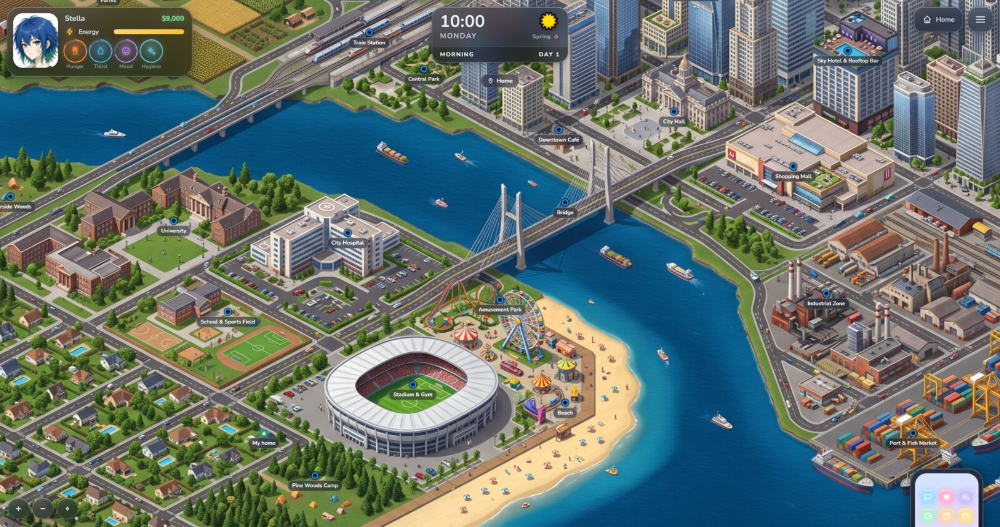
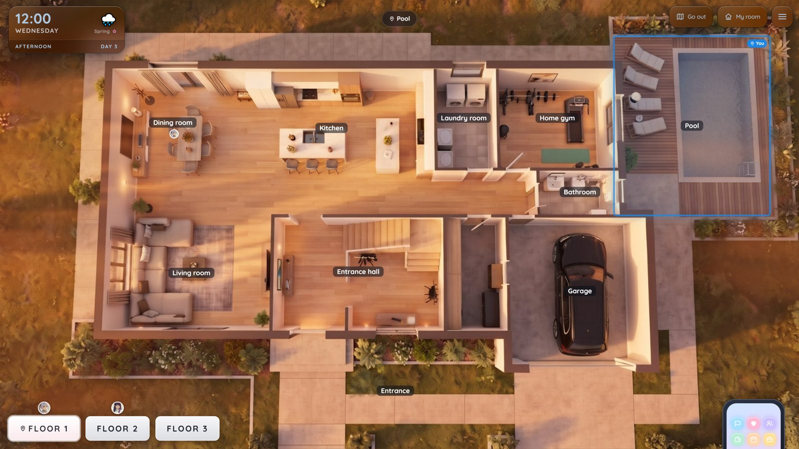
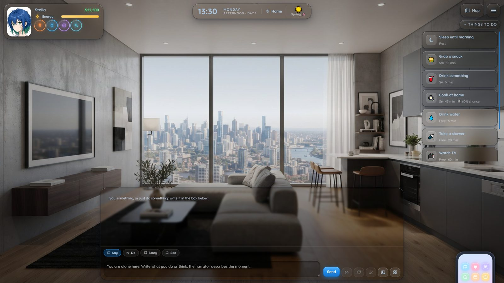
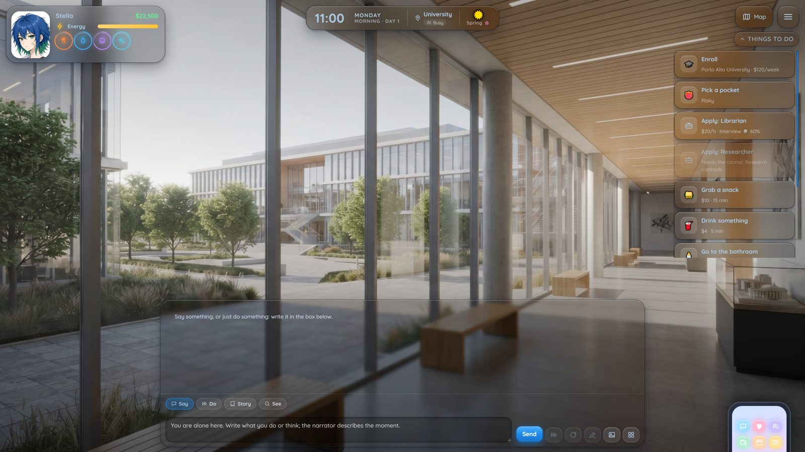
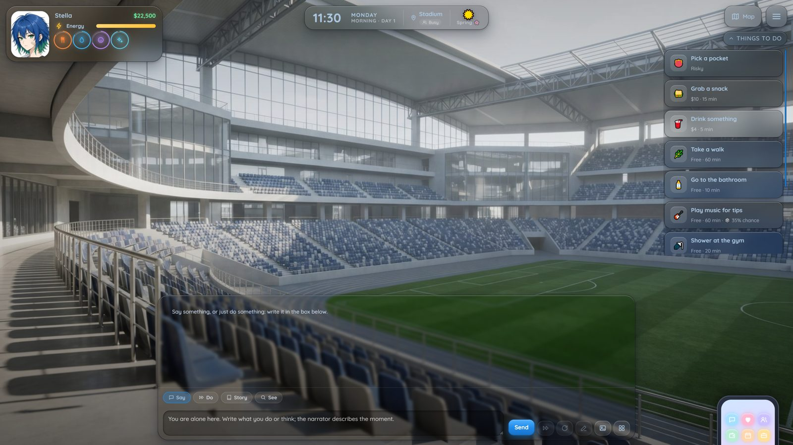
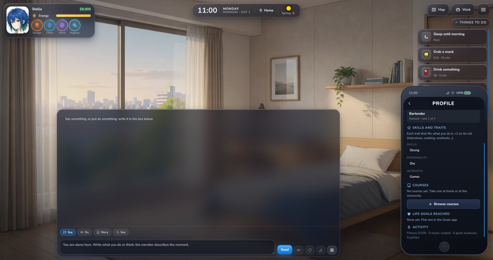
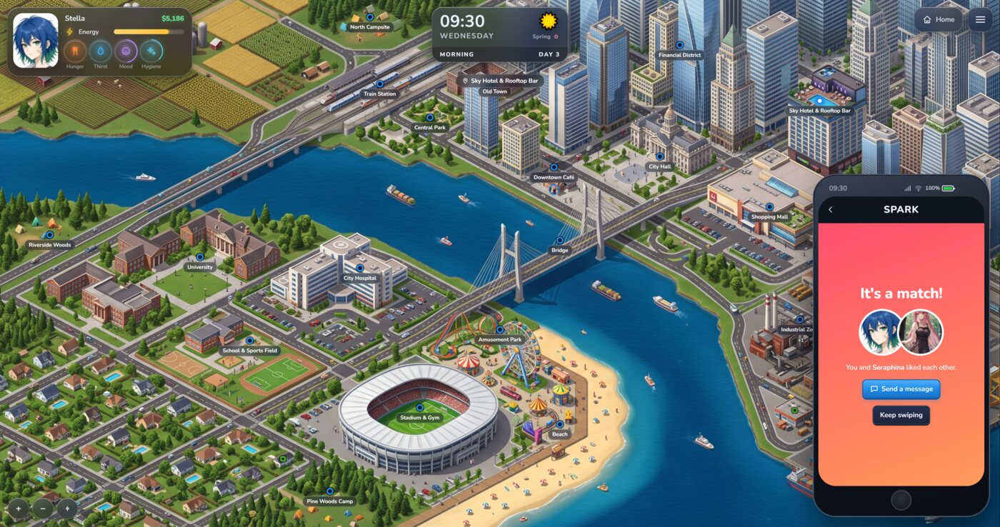
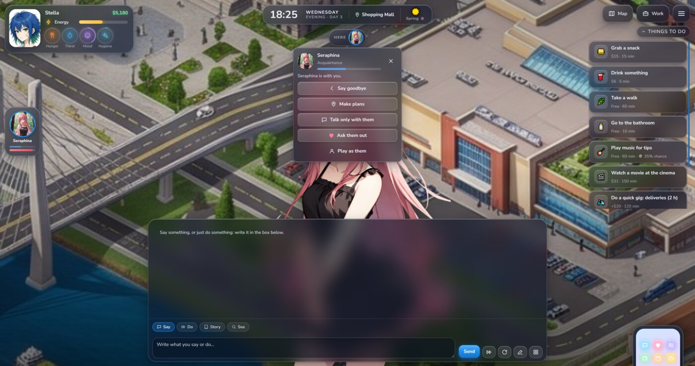
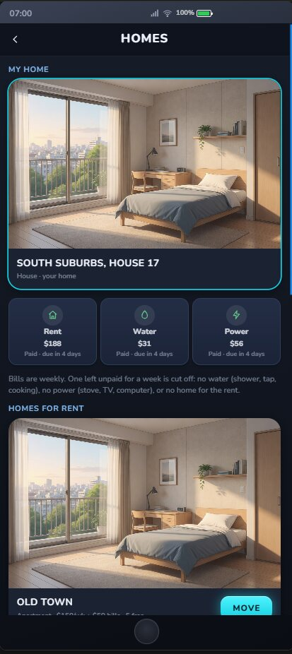
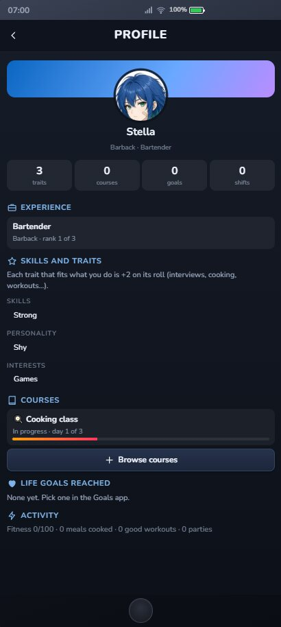

# Mundi

> ## About this fork
>
> This fork of [tjalis/Mundi](https://github.com/tjalis/Mundi) is Mundi 0.2.1 plus a set of new features, offered back to the author as pull requests (one per feature). Everything below this box is the original README.
>
> **To play it:** install `https://github.com/Hitdaman/Mundi` with the branch **`all-features`** (in SillyTavern, Extensions → Install extension, then fill in the branch). That branch also unlocks the medieval style and the RPG mode, which 0.2.1 keeps locked for a later release. Apart from this box, the `main` branch here is the same as the original.
>
> ### What's different
>
> - **Play in any chat:** attach a Mundi world to an existing one-on-one or group chat, and detach it again.
> - **Worlds from lorebooks:** the AI reads your lorebooks and builds the world (maps, places, people, jobs, factions). It then fills every World creator tab, adds everyday places the lorebooks didn't mention, and has hidden or restricted places, buildings with floors, and gates that open up as the story goes.
> - **Mundify:** make a Mundi copy of a character card, a lorebook or a persona. **Fill from my persona** sets up a new game from a persona, its lorebook and a chat. **Meters** (Warmth, Weariness…) show as HUD bars that the AI reads and updates. Your home can be a room inside a building.
> - **ComfyUI sprites:** draw Expressions sprites for anyone who has none, from the scene or the Library (all 28 expressions, outfits, new faces). CG pictures get their own page. **Scene looks** keep outfits and conditions (wet, hurt…) in step with the story, and each character has a list of things they always wear.
> - **Paint a world with ComfyUI:** maps, backgrounds and the cover, laid out from the pins, and painted at the right scale (a globe, a country, an island, a city). Earth uses NASA's Blue Marble. **Draw into the map** adds a new place to a map picture.
> - **ComfyUI tools:** a Stop button for everything Mundi draws, and a LoRA picker for sprites, CG and maps.
> - **Character creation:** open traits with "write your own", Flaws, and RPG systems to pick from (Classic fantasy, Martial arts, Superpowers, Nen hunter, Solo dungeon, Space saga, Cultivation), or a system the AI writes from lorebooks. Skills come from a budget, and you choose your weapon.
> - **RPG death is real:** HP bands with penalties, death at 0 HP unless someone treats you in time, harm in the story costs HP, the dead sometimes rise, and you can carry on as someone else.
> - **Quests you find:** on boards, by asking around, from lorebooks and from the story. There are also new things to do: wound care, locked doors, searching for places, inns, waiting.
> - **People from the story:** people the AI introduces can be added as real characters, with a card, home, job and sprites.
> - **New jobs** in Porto Alto and Nova Vega, with ten-rank career paths.
> - **AI tests:** check your model against Mundi's lorebook steps.
>
> Everything is built and tested on 0.2.1, and all of the original tests pass.

**Open worlds inside SillyTavern.** Mundi turns a SillyTavern group chat into a life you live: a city with a map and a clock, needs to look after, a job, bills, people with their own days, and the story the AI writes around what you do.

<p align="center"></p>

It is a SillyTavern **extension** (no server plugin). Everything is built on what SillyTavern already has: your character cards, personas, lorebooks and group chats. A save *is* a chat.

## What you can do

- **Live in a world.** A map of places, time that moves when you act, weather and seasons. Energy, hunger, thirst, mood and hygiene drop over time.
- **Talk.** A visual-novel scene with Say / Do / Story / See. Type `@` to pick who answers. The engine keeps the numbers (time, money, relationships); the AI writes the scene.
- **Relationships.** Friendship and romance bars with levels, approval, feelings that fade, dates, proposals, marriage, a baby. People keep their own routines: find them, or text them.
- **Work and money.** Job interviews (a d20 roll with your traits as bonus), shifts, promotions, quick gigs, courses that teach traits, weekly rent, water and power that get cut off if you don't pay. Easy / Normal / Hard.
- **A phone.** Messages, People, Jobs, Bank, Homes, Chirp (social), Spark (dating), Calendar, Journal, Shop, Goals, Profile and Help.
- **Households and "Play as".** Live with family or roommates, then switch to playing any of them.
- **A diary.** Each night the day is written as a short entry, so the story remembers what happened.
- **Make it yours.** Layouts (Visual novel, Classic, Cards), colors with transparency, presets that tint the HUD glass, a world creator for your own maps and rules.
- **Phones.** Upright and sideways layouts, with their own scale for the HUD.
- **A tour.** Stella shows you around in a practice world. No AI needed.
- **Home mode.** A more role-play focused way to play: one house, the characters you choose, no work or bills. Pick the rooms, draw a floor plan, go out and come back.
- **In your language.** The interface is in English, Português (Brasil) and Español (Settings → Interface → Language).

It comes with **Porto Alto**, a modern coastal state with five cities (Midtown, Palm Coast, Maple Heights, Pinecrest and Green Valley), and **The Shared House** for Home mode. The medieval style (Valdoria) and the RPG mode are coming in a later update.

See [CHANGELOG.md](CHANGELOG.md) for what changed in each version.

## Screenshots (0.2)

| | | |
|---|---|---|
|  |  |  |
|  |  |  |
|  |  |  |

## Screenshots

| | |
|---|---|
|  |  |
|  |  |
|  |  |

On a phone:

<p align="center">
  
  
  
</p>

## Install

1. In SillyTavern, open **Extensions → Install extension**.
2. Paste `https://github.com/tjalis/Mundi` and install.
3. Reload SillyTavern (Ctrl+F5). Open Mundi from the **Extensions menu** (the magic wand next to the chat box). The tour starts the first time you open it.

Works with SillyTavern 1.19 or newer. Any chat-completion or text-completion API works; a context of about 30k tokens is a good size.


## Building from source

The repository ships the compiled `dist/` and `style.css`, so you don't need to build to use it. To change the code:

```sh
npm i -g typescript
./build.sh        # src/*.ts → dist/, css/*.css → style.css
```

## Credits

- Sounds by [Kenney](https://kenney.nl) (CC0).
- Seraphina is SillyTavern's default character; her picture is bundled for the tour.

## License

[AGPL-3.0](LICENSE), the same license as SillyTavern.
